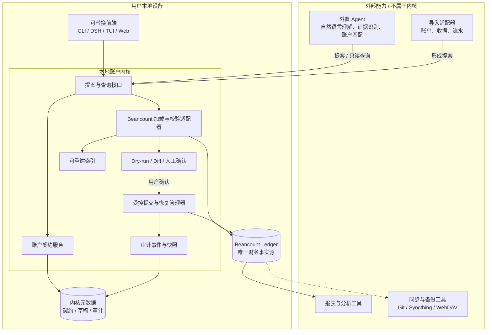
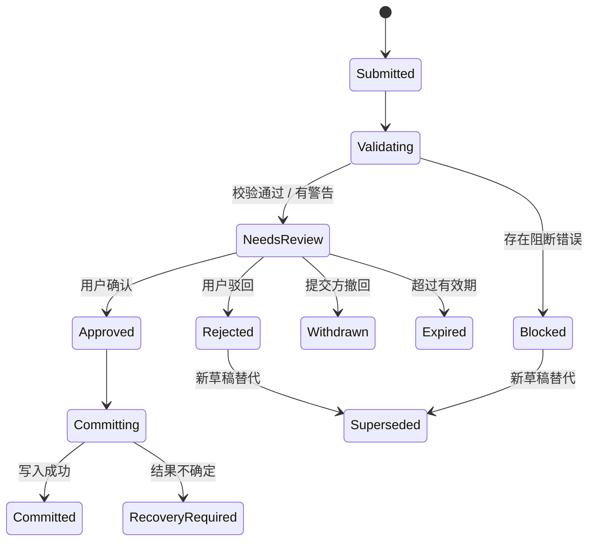

# 本地账户内核 v0.1 设计规格（修订版）

- **文档状态**：修订稿，已对齐现行基线；不再单独承担决策职责
- **版本**：v0.1.1-revised（替代 v0.1-draft）
- **依据**：《[顶层设计摘要](./design-summary.md)》（2026-11-15 更新版）与《[本地账户内核_v0.1_工程决策冻结与原型实施计划](./v0.1-implementation-plan.md)》
- **定位**：把上述两份文档的原则与冻结决策展开为实现与验收细节；冲突时以摘要和实施计划为准，本文不另立事实
- **前身**：v0.1-draft，基于已失效的旧《Ledger.md》摘要生成，修订清单见文末 [附录 C](#附录-c相对-v01-draft-的修订记录)

> 本文不把尚未确认的建议写成既定事实。每项设计分别标注为：**[摘要已明确]**、**[已冻结]**（实施计划 ADR）、**[本次建议]**、**[待决]**。

---

## 0. 执行摘要

### 0.1 一句话定义

**本地账户内核是一个围绕 Beancount Ledger 运作的本地控制与执行层：它读取账本、解释账户契约、验证外部提案、展示写入影响，并在用户授权后受控地修改账本。**

Agent 负责理解和提出，内核负责约束和执行，用户负责授权，Ledger 负责保存财务事实。

### 0.2 v0.1 的边界

v0.1 只验证一个闭环：

1. 内核加载一个用户指定的 Beancount 账本目录。
2. 内核读取账户定义、余额和账户契约。
3. 外部 Agent 提交一笔或一组交易草稿及其证据。
4. 内核对草稿执行完整账本校验、账户契约校验和 dry-run。
5. 用户查看差异并明确确认。
6. 内核在并发检查通过后写入账本，留下可追溯审计记录。
7. 出现进程中断或提交异常时，内核能够检测并进入安全恢复流程。

v0.1 **不**尝试构建完整记账 App，不内置 AI 推理，不负责导入所有银行账单，不实现多设备多主写入，也不实现预算、通知或分析仪表盘。

### 0.3 最重要的架构澄清

现行《[顶层设计摘要](./design-summary.md)》已不再使用"账本目录唯一写者"这一表述。v0.1 的定义是：

> **内核是所有自动化写入的唯一受控入口；用户保留直接编辑账本的最高权限；用户也可以授权 Agent 直接改文件——此时该写入属于外部修改，内核不假装它受控。**

因此写入路径有三条，而不是一条禁令（见《实施计划》2.1）：

1. **受控自动化写入**：Agent 经 MCP/API 提交草稿，由内核校验、确认、提交。
2. **用户直接写入**：任何编辑器、Git、脚本。内核不阻止，只负责发现与记录。
3. **用户授权 Agent 直写**：内核通常无法在操作系统层面区分 Agent 与用户，按外部修改处理。

内核对第 2、3 条的职责是**发现、识别、归因**，不是阻止；这三件事必须分开定义（见《实施计划》2.2）：SHA-256 只能证明"内容变了"，不能证明"是谁写的"。

进程权限隔离（独立用户、只读挂载、容器）仍然值得做，但它降低的是风险，不是安全边界。不能宣称"Agent 永远无法绕过"——同一 OS 用户下通常无法保证操作系统层面区分 Agent 与用户。

---

## 1. 原则、来源与决策状态

### 1.1 现行《[顶层设计摘要](./design-summary.md)》已经明确的原则

以下内容来自 2026-11-15 更新后的摘要，不是本稿新增的产品判断：

- 账本文件是唯一财务事实源，保持普通、可访问、可导出、可带走的 Beancount 纯文本格式。
- 账户是产品核心语义；内核负责账户定义、层级、别名、状态、对账及余额断言相关能力。
- Agent 外置、可替换，不绑定模型；Agent 理解证据、匹配账户、生成交易草稿，并通过文件收件箱或本地 API/MCP 提交提案。
- **Agent 默认走提案协议，但用户也可以直接授权它改本地文件**；不假设 Agent 永远不直写。
- 写入前执行 dry-run 并展示 diff；AI 提案必须可审计。
- 审计与恢复是重要能力；索引和缓存可以从纯文本账本重建。
- DSH、CLI、Web、PWA、移动端只是可替换交互前端。
- 同步、报表、导入、备份、通知和消费分析不应成为内核的核心依赖。
- 账本文件可由普通编辑器打开，并可使用 Git 管理；不以私有二进制格式取代 Beancount。
- 审核分级（低风险自动提交）在 MVP 阶段不做。

### 1.2 已冻结的实现约束

以下约束已在《实施计划》第 1 节冻结为 ADR-001～ADR-013，这里只做规格层面的展开，不再作为"建议"：

1. 一个账本目录对应一个 `ledger_id`。（ADR-001）
2. 同一时刻只允许一个内核实例取得该账本的提交锁；该锁只协调内核实例，不声称能锁住所有编辑器。（ADR-002）
3. v0.1 每次自动化提交只修改一个预先配置的目标账本文件（`write_target`），且该文件必须位于账本根文件 `include` 闭包内。（ADR-003）
4. 一次提交只写入完整交易块，不由内核重排或重写整份账本。（ADR-004）
5. 账本或账户契约在提案确认后发生变化，原确认默认失效并重新校验；只有 ADR-013 的已知转移可沿用。
6. 同步盘/Git 可以用于复制和版本管理，但不承担多主并发写入和自动冲突合并。（ADR-011）
7. 已入账财务事实的业务修正，优先用冲销/调整交易保留痕迹；文件快照恢复只用于技术故障恢复，不等同于会计冲销。（ADR-010）
8. Dry-run 重载后的新增条目必须与提案逐项一致，不等即阻断。（[ADR-012](adr/ADR-012-delta-assertion.md)）
9. 只有"已知转移"可在严格条件下沿用旧批准；外部变化一律重新校验。（[ADR-013](adr/ADR-013-known-transition.md)）

### 1.3 仍需产品决策的事项

以下与《实施计划》第 12 节保持一致，本文不重复论证：

- 账户契约文件如何建模（YAML schema、版本迁移），以及与账本目录是否一起纳入 Git。
- 账户契约哪些规则属于硬性阻止，哪些只产生警告。
- 外部 Agent 通过 MCP stdio、本地 HTTP API，还是两者接入。
- 首个人工审核前端是 CLI/TUI 还是极简本地 Web 页面。
- 对于账本中已有 Beancount 插件，是否允许内核默认执行，以及如何处理不可信插件。
- 外部快照保留策略，以及提交原语（同目录原子替换 vs `O_APPEND` 追加）的选择，须由 P0 故障注入实验决定。

已冻结、不再待决：单 `write_target`（ADR-003）、只追加完整交易块（ADR-004）、v0.1 全部草稿人工确认（ADR-006）、不做多设备多主写入（ADR-011）。

---

## 2. 系统边界与组件职责

### 2.1 逻辑架构



### 2.2 组件职责

| 组件 | 职责 | 明确不负责 |
|---|---|---|
| Ledger | 保存已确认的财务事实及 Beancount 指令 | 不保存 Agent 草稿状态，不保存模型运行状态 |
| Kernel Core | 账户查询、契约检查、草稿生命周期、校验编排、写入控制 | 不做模型推理，不做完整报表产品 |
| Beancount Adapter | 调用 Beancount 官方加载/校验链路，提取解析结果、错误和账户余额 | 不自行实现完整 Beancount 语法、booking 或记账规则 |
| Contract Store | 保存账户扩展契约和规则版本 | 不成为账户余额或交易事实的第二真相源 |
| Draft Store | 保存不可变提案正文和证据引用 | 不直接改变 Ledger |
| Audit / Recovery | 记录提案、确认、提交、外部变化和恢复事件 | 不以 Git 历史替代业务审计 |
| Cache / Index | 加速账户树、余额和查询 | 不保存不可重建的关键事实 |
| Agent | 理解输入、提出账户匹配和交易草稿 | 默认经提案协议写账（不自行确认、不改契约）；用户显式授权直写时，该写入按外部修改处理，内核不视为受控提交 |
| Frontend | 展示状态、diff、警告并收集用户决策 | 不实现自己的 Beancount 语义或绕过内核写文件 |
| External Tools | 同步、报表、数据导入、备份等可插拔能力 | 不成为内核运行的必要依赖 |

### 2.3 建议的进程模型

**[本次建议]** v0.1 采用"一个内核服务进程 + 多个客户端适配器"的模型：

- `kernel-core`：核心领域逻辑和用例，不依赖 HTTP、MCP 或 UI。
- `kernel-daemon`：持有账本目录访问能力，负责文件监测、校验、提交锁和恢复。
- `kernel-cli`：本地管理与人工审核入口。
- `kernel-mcp`：可选适配器，将查询和提案提交能力暴露给 Agent。

MCP 和 CLI 必须调用同一组 Core 用例，不得分别实现账户规则或写入逻辑。

初始实现可以先把 Core、Daemon、CLI 放在同一 Python 包中，但逻辑边界应保持清楚。不要为了"微服务化"提前拆成网络服务集群。

---

## 3. 数据模型与存储归属

### 3.1 四类数据必须分开

这是 v0.1 最重要的数据建模约束。

| 类别 | 例子 | 权威来源 | 可否重建 |
|---|---|---|---|
| 财务事实 | 交易、账户 Open/Close、Balance 指令、价格等 | Beancount Ledger | 否；这是用户要保留的事实 |
| 账户契约 | 别名、允许的操作、账户级策略、Agent 范围 | 版本化契约文件 | 否；可从备份恢复，但不是从余额推导 |
| 派生状态 | 当前余额、账户树、余额断言结果、账户生命周期状态 | Beancount 加载结果 | 是 |
| 工作流状态 | 草稿、审核状态、提案证据引用、审计事件 | 内核元数据目录 | 否；需要持久保存，但不属于财务事实 |

"Ledger 是唯一真相源"准确指**财务事实的唯一真相源**。账户契约和审核记录是内核运行所需的权威元数据，但不能改变 Ledger 对财务事实的权威地位。

### 3.2 建议目录结构

```text
my-ledger/
├── main.beancount
├── accounts/
│   └── ...
├── transactions/
│   └── ...
├── documents/
│   └── ...
└── .ledger-kernel/
    ├── kernel.toml            # 账本绑定、write_target、版本等
    ├── contracts.yaml         # 账户契约；建议纳入 Git
    ├── drafts/
    │   └── <draft-id>.json    # 提案正文；提交后仍保留
    ├── audit/
    │   └── events.jsonl       # 追加式审计事件
    ├── journal/
    │   └── <commit-id>.json   # 提交事务日志 / 崩溃恢复依据
    ├── snapshots/
    │   └── <commit-id>/       # 写入前快照或目标文件副本
    └── cache/
        └── index.sqlite       # 纯派生索引，可删除重建
```

**目录约束：**

- `.ledger-kernel/` 是普通、可备份、可导出的文件目录，不是封闭数据库格式。
- `contracts.yaml`、草稿、审计和 journal 应可读、可导出。建议纳入用户自己的 Git 管理范围，但可允许用户选择不提交包含敏感证据的内容。
- `index.sqlite` 仅用于缓存和索引；删除后必须能够从 Ledger、契约文件和持久工作流记录恢复必要状态。
- 访问令牌、密钥等秘密不写入 Git 管理的配置文件，放在系统凭据存储或权限受限的本地文件中。
- 证据原件可存放在用户指定目录；草稿保存相对路径/资源标识和内容哈希。不要默认把完整收据、账单复制到多个位置。

### 3.3 Account 模型

账户实体分为定义、派生状态、契约三部分。

#### A. Account Definition（来自 Ledger）

由 Beancount 的账户生命周期指令及其配置构成，例如：

- `account_name`
- `open_date`
- `close_date`（如存在）
- `declared_currencies`
- `booking_method`
- `source_file` / `source_line`

内核不自行复制维护一份可独立修改的账户开立/关闭事实。

#### B. Account Derived State（运行时计算）

- `lifecycle_status`：未开立 / 开立 / 已关闭等，由 Ledger 指令和 Beancount 解析结果推导。
- `balances`：按日期和货币计算的余额，不可直接修改。
- `assertion_status`：余额断言通过、失败或未设置。
- `last_posting_date`：由交易推导。
- `pending_draft_count`：从工作流状态计算。
- `reconciliation_status`：需要明确它是内核根据策略推导的工作流状态，不应伪装成 Beancount 的原生语义。

#### C. Account Contract（扩展契约）

建议初始只支持可确定性检查的字段：

```yaml
schema_version: 1
accounts:
  Assets:Bank:Checking:
    aliases:
      - 工资卡
      - 主银行卡
    policy:
      allowed_agents:
        - receipt-agent
        - statement-agent
      allowed_currencies:
        - CNY
      allowed_tags:
        - recurring
        - reimbursement
      required_tags: []
      reconciliation:
        cadence: monthly
        hard_deadline: false
      balance_policy:
        mode: warn_only
        min: null
        max: null
```

字段说明：

- `aliases`：仅用于候选匹配，不代表用户已经确认某个外部名称必然对应此账户。
- `allowed_agents`：限制哪些 Agent 可以向该账户提交提案；不赋予写入权限。
- `allowed_currencies`、`allowed_tags`、`required_tags`：可做确定性校验。
- `reconciliation`：描述用户的对账节奏；v0.1 默认只提示，不自动阻止交易。
- `balance_policy`：默认仅警告。余额上限/下限不应在未确认语义前自动成为硬约束。

**不建议 v0.1 过早支持任意脚本形式的账户规则。** 自定义 Python hook 会引入代码执行、安全、可复现和版本兼容问题。先把契约限制为声明式、可解释、可测试的规则集合。

### 3.4 草稿模型

每份草稿是一项不可变提案。修订提案时创建新的 `draft_id`，并通过 `supersedes` 关联旧草稿，不覆盖原始提交内容。

```json
{
  "schema_version": 1,
  "draft_id": "drf_01J...",
  "created_at": "2026-11-15T20:00:00+09:00",
  "expires_at": null,
  "submitted_by": {
    "agent_id": "statement-agent",
    "agent_version": "0.4.0"
  },
  "ledger_id": "home-ledger",
  "base_revision": "sha256:...",
  "contract_revision": "sha256:...",
  "operation": "append_transactions",
  "transactions": [
    {
      "date": "2026-11-15",
      "flag": "*",
      "payee": "Example Bookstore",
      "narration": "Books",
      "tags": [],
      "links": [],
      "postings": [
        {"account": "Expenses:Books", "units": "120.00", "currency": "CNY"},
        {"account": "Assets:Bank:Checking", "units": "-120.00", "currency": "CNY"}
      ]
    }
  ],
  "evidence": [
    {
      "kind": "file",
      "locator": "../documents/2026-11/statement.pdf",
      "sha256": "...",
      "page_or_region": "page 2"
    }
  ],
  "account_refs": [
    "Expenses:Books",
    "Assets:Bank:Checking"
  ],
  "confidence": 0.91,
  "rationale_summary": "依据账单商户、金额和日期生成；账户匹配来自账户别名。",
  "supersedes": null
}
```

约束：

- 金额以十进制字符串表达，不接受 JSON 浮点数作为金额的权威输入。
- `confidence` 仅供审核时参考，不构成自动批准条件。
- `rationale_summary` 是简短、可审查的理由摘要，不要求记录模型的内部思维过程。
- 证据可以是文件、文本片段或外部资源引用；有文件时保存哈希，防止审核后证据被悄然替换。
- Agent 不得在草稿中传入任意路径作为写入目标；写入目标由账本配置决定。
- v0.1 `operation` 只支持追加完整交易，不支持批量改写历史交易、删除账户或任意编辑账本文件。

### 3.5 Ledger Revision（账本版本指纹）

不能只依靠主文件的修改时间判断账本是否变化。建议计算 `ledger_revision`：

1. 解析主账本及其 `include` 文件闭包。
2. 对每个被加载文件计算 SHA-256。
3. 将规范化相对路径与文件哈希按路径排序。
4. 将 Beancount 版本、影响校验语义的加载配置版本纳入 `engine_fingerprint`。
5. 对规范化清单计算总哈希。

另计算 `contract_revision`，覆盖 `contracts.yaml` 的内容哈希。

缓存索引、审核结果和批准动作必须绑定这两个 revision。任一变化都使原校验结果失效。

---

## 4. 草稿生命周期与审核协议

### 4.1 状态机



状态说明：

- `Submitted`：已接收并持久化，尚未信任其内容。
- `Validating`：正在执行结构、账本和契约检查。
- `NeedsReview`：校验无阻断错误，可以进入人工审核；警告必须展示。
- `Blocked`：有语法、平衡、账户生命周期或硬契约错误，不能批准。
- `Approved`：用户批准了某一特定校验结果和账本 revision。
- `Committing`：进入受控写入事务。
- `Committed`：主账本已更新且提交事件已确认。
- `RecoveryRequired`：内核自身提交结果不确定（崩溃、中断），暂停该账本后续写入。外部编辑导致的无效账本属于账本状态 `LedgerInvalid`，不是草稿状态。
- `Rejected` / `Withdrawn` / `Expired`：保留状态事件，不删除草稿历史。

> `Stale` 不是独立状态，而是"草稿绑定的 revision 已过期"的派生标记：草稿进入 `NeedsReview`/`Approved` 后若 ledger 或 contract revision 变化，即标记 stale 并强制重新校验；例外只有 ADR-013 的已知转移。已 `Committed` 的草稿不回退，按 7.2 的会计修正流程处理。

### 4.2 提交、证据、确认、撤销四段式

1. **提案**：Agent 提交交易结构、账户候选、金额、置信度和来源。
2. **证据**：保存证据定位、哈希和可展示摘要；证据无法读取时明确标记，不假装已经核验。
3. **确认**：用户确认的对象不是"草稿大概内容"，而是 `draft_id + validation_id + ledger_revision + contract_revision` 这一组确定版本。
4. **撤销**：提交前可以撤回或驳回；提交后不能把"撤销"解释为删掉历史，而应另建修正/冲销交易。

### 4.3 防止重复提交

- 每个 Agent 请求带 `idempotency_key`。
- 相同 Agent、相同 key 的重复请求返回同一 `draft_id`，不能重复生成交易。
- `draft_id` 和 `commit_id` 全局唯一。
- 已经处于 `Committed` 的草稿，任何重复确认都必须返回原提交结果，不得再次写入。

### 4.4 校验结果

校验结果应包含：

```json
{
  "validation_id": "val_...",
  "draft_id": "drf_...",
  "ledger_revision": "sha256:...",
  "contract_revision": "sha256:...",
  "engine_fingerprint": "beancount-x.y.z+kernel-a.b.c",
  "status": "pass_with_warnings",
  "checks": [
    {"code": "BEANCOUNT_LOAD", "severity": "pass", "message": "账本加载成功"},
    {"code": "ACCOUNT_CONTRACT", "severity": "warning", "account": "Assets:Bank:Checking", "message": "该账户已超过建议对账周期"}
  ],
  "diff": {
    "changed_files": ["transactions/current.beancount"],
    "postings": [],
    "balances_before": [],
    "balances_after": []
  }
}
```

必须区分：

- **阻断错误**：语法错误、Beancount 原生校验错误、账户未开立/已关闭、硬契约违反、revision 过期等。
- **警告**：低置信度、对账周期已到、余额超出建议范围等非硬约束。
- **信息**：影响账户、写入文件、余额变化、证据来源等。

不能以一个总分掩盖具体错误。

---

## 5. Beancount 解析与校验适配

### 5.1 原则

**[摘要已明确]** 账本保持 Beancount 格式，内核只实现账户相关产品语义，不重新实现完整记账语言。

**[本次建议]** 内核通过 `BeancountAdapter` 隔离版本差异，优先调用 Beancount 官方加载与校验管线，不从文本层面自行判断交易平衡、成本、booking 或账户生命周期。

Beancount 官方源码文档描述了加载、解析、booking、插件/操作校验和账户余额 realization 等处理阶段，并指出 `beancount.api` 是面向外部使用的入口，`loader.py` 负责协调加载过程。参见：

- [Beancount 源码结构与 API 说明](https://github.com/beancount/beancount/blob/master/beancount/docs.md)
- [Beancount `beancount.loader` API 参考](https://beancount.github.io/docs/api_reference/beancount.loader/)：`load_file()` 打开输入文件、解析、运行 transformations 和校验，并返回 `(entries, errors, options_map)`。
- [Beancount 用户与开发者文档入口](https://beancount.github.io/docs/)

### 5.2 Adapter 责任

建议定义内部接口，不让领域层直接依赖 Beancount 的内部对象：

```python
class BeancountAdapter(Protocol):
    def load_ledger(self, root_file: Path) -> LedgerLoadResult: ...
    def validate_candidate(self, root_file: Path, candidate: CandidateWrite) -> ValidationResult: ...
    def get_account_tree(self, load_result: LedgerLoadResult) -> AccountTree: ...
    def get_balances(self, load_result: LedgerLoadResult, as_of: date) -> list[AccountBalance]: ...
    def render_transaction(self, transaction: ProposedTransaction) -> str: ...
```

`LedgerLoadResult` 至少封装：entries、errors、options、加载文件集合、账户树/余额索引和 engine fingerprint。

### 5.3 校验流程

候选交易不得只做"局部金额加总为零"检查。必须在临时工作区对完整账本执行加载与校验，因为：

- 账户生命周期与交易日期有关。
- booking、成本、货币和精度规则可能影响结果。
- `include` 文件和插件可能改变最终加载结果。
- Balance assertion 是相对于此前交易计算的。

建议流程：

1. 读取当前账本 revision，确认账本基线可加载。
2. 将账本纳入临时工作区，保持相对目录结构和 include 关系。
3. 在配置的 `write_target` 中加入候选交易块。
4. 对临时账本执行与生产一致的 Beancount 加载和校验。
5. 按 ADR-012 做增量断言：重载后新增条目须与提案逐项相等，且闭包内其他文件无字节变化；不等即阻断，不提供"仍然确认"。
6. 将 Beancount errors 映射为内核标准错误代码。
7. 在 Beancount 校验成功后，再执行账户契约附加检查。
8. 从加载结果中计算受影响账户的余额变化，生成 diff。
9. 丢弃临时工作区；不修改真实账本。

第 5 步是防注入关键：narration 等字段是自由文本，带换行的字符串可伪造额外交易。字段规则、片段指纹与展示隔离见 ADR-012，本文不复制。

### 5.4 错误策略

v0.1 建议采用 fail-closed：

- 当前账本无法完整加载或存在既有 Beancount 错误时，默认禁止自动提交。
- 不尝试"只忽略本次交易之外的错误"。
- 如果未来必须支持含历史错误的账本，应先定义基线错误集合和差分错误规则，不在 v0.1 偷渡。

### 5.5 插件信任

Beancount 插件可能参与加载处理。因此，内核运行账本时应将账本配置和插件视为用户明确选择信任的代码环境：

- 仅对用户明确选择的本地账本启用其插件配置。
- 对 Agent 提交的草稿，不接受其指定插件、加载路径或运行代码。
- 远程 Agent 不能通过提案让内核加载任意模块。
- v0.1 不提供用户自定义内核 Python hook。

### 5.6 版本兼容

**[待决]** 需要选定首个支持的 Beancount 主版本，并在测试中固定依赖。Adapter 隔离 v2/v3 或未来 API 差异；不承诺"跟随最新版自动兼容"。升级 Beancount 时运行真实账本回归测试，再升级 engine fingerprint。

---

## 6. 提交事务、并发与外部文件变化

### 6.1 v0.1 并发模型

建议采用：**单账本、单活跃内核、串行提交、一个自动写入目标文件**。

- 内核进程启动时为账本取得独占锁；不能取得锁就进入只读模式或退出，不允许两个内核同时提交。
- 提交期间持有进程级/操作系统文件锁。
- 每份草稿携带提交时所基于的 `ledger_revision` 和 `contract_revision`。
- 确认和真正写入之间再次读取指纹；外部变化一律拒绝提交并要求重新校验，已知转移按 ADR-013 处理。
- 同步工具只负责复制文件，不负责协调两台设备同时写入。

### 6.2 多设备策略

v0.1 **不支持多设备多主写入**。

建议规则：

1. 指定一台设备作为主账本节点。
2. 其他设备可以读取副本，或经明确授权向主节点请求账户查询和提交草稿。
3. 不允许两个设备各自离线提交后再靠 Syncthing/Git 自动合并交易文件。
4. 若检测到同步引入的未预期变更，内核刷新 revision、使旧草稿失效；出现冲突标记或加载错误时暂停写入，要求人工处理。

未来可研究带租约的主节点、远程内核 API 或显式 check-out/check-in，但不属于 v0.1。

### 6.3 用户直接编辑与外部变化

用户直接编辑是 Beancount 工作方式的一部分，内核不阻止，也不把它当作异常：这是《实施计划》2.1 中的"用户直接写入"路径。

v0.1 的处理策略：

- 内核每次操作前计算账本指纹；必要时监视文件变更事件，但不能只信赖文件系统 watcher。
- 检测到外部变化后重新加载整个账本、重建缓存并增加 `ExternalChangeDetected` 审计事件。
- 所有基于旧 revision 的待审核草稿标记为 `Stale`，需要重新验证。
- 检测到语法错误或无法解释的冲突时，暂停内核自动提交；不自动覆盖用户内容。
- 用户手工修改可以直接成为新的账本事实；内核记录其检测时间和前后可见差异（若此前有快照）。

**明确限制：** 普通编辑器通常不会遵守内核文件锁。内核可以在提交前重新哈希并采用原子替换降低竞争窗口，但无法对不配合锁协议的外部进程提供绝对的 compare-and-swap 保证。若需要强保证，必须使用受控编辑器/插件，或在提交期间由操作系统权限隔离账本目录。v0.1 应如实记录此限制，不宣称能消除所有并发写入竞态。

外部变化后的状态机（与《实施计划》第 4 节一致）：

```text
Clean
  └─ revision changed → ExternalChangeDetected
       ├─ full Beancount load valid → Reloaded / NewRevision
       │    ├─ invalidate stale drafts
       │    └─ record observation event
       └─ Beancount errors exist → LedgerInvalid
            ├─ block all controlled commits
            ├─ preserve current files and observation data
            └─ wait for user correction
```

`RecoveryRequired` 只用于内核自身提交结果不确定；外部编辑造成的无效账本用 `LedgerInvalid`。两者不能混用，否则会把"用户改坏了文件"误报成"内核提交失败"。

### 6.4 Agent 的真实权限边界

只把"Agent 不写账本"写在系统提示词或 MCP 描述中，不构成安全边界；反过来，也不能假设能靠权限彻底禁止直写（见 0.3）。

下表是**降低风险的手段清单**，不是"能否直写"的判定：

| Agent 运行方式 | 实际效果 | v0.1 评价 |
|---|---|---|
| 远程 Agent，只能调用内核 API/MCP | 物理上没有账本文件系统权限 | 最省事，优先 |
| 本地 Agent 独立 OS 用户/容器，账本只读挂载 | 直写被系统权限挡住，但依赖部署正确 | 推荐，但非默认保证 |
| 本地 Agent 与内核同一 OS 用户 | 可绕过 API 直接改文件，内核只能事后发现 | 常态；按外部修改观测与归因 |
| Agent 获得账本目录可写权限 | 无隔离，直写与用户编辑不可区分 | 不作为"受保护模式"宣传 |

在 POSIX 系统可用独立用户、目录权限、只读挂载和进程沙箱；Windows 使用独立账户/ACL/受限进程等对应机制。具体实现取决于部署平台。

用户本人仍是设备所有者，可以直接编辑文件、改配置或移除内核；这属于用户主权，不应被产品技术手段阻止。

### 6.5 原子提交流程

v0.1 每次只追加到 `write_target` 一个文件，推荐事务流程：

1. 确认草稿处于 `Approved`，且批准绑定的 revision 与当前一致。
2. 取得账本提交锁。
3. 重新计算 Ledger 和 Contract revision；不一致则停止。
4. 对当前目标文件创建写前快照，计算 `before_hash`。
5. 生成完整的新文件内容到同目录临时文件，flush + fsync。
6. 对临时工作区再次运行 Beancount 完整校验和契约校验。
7. 写入 `PREPARED` journal 事件，保存 before/after hash、临时文件路径、draft_id、验证 ID 和快照定位，并 fsync。
8. 再次检查源文件 hash，防止生成期间发生外部修改。
9. 使用同文件系统原子替换（例如 rename/replace）应用新文件。
10. fsync 目标目录；追加 `COMMITTED` 审计事件并 fsync。
11. 将 journal 标记为完成，释放锁并刷新索引。

原子替换避免用户看到半写入文件，但不会自动解决未遵守锁协议的外部编辑冲突。

> [!note] 该流程以"同目录临时文件 + 原子替换"为例。若 P0 故障注入实验最终选择 `O_APPEND` 追加写（见《实施计划》第 7 节），第 5、8、9 步需要改写：不再生成整份新文件，而是校验后直接追加并检查尾部完整性。选择必须在写实现前冻结，不能两套并存。

### 6.6 跨文件事务的限制

v0.1 一次提交不得同时修改多个账本文件。原因是普通文件系统无法为多个不同文件提供通用原子事务。

如果后续需要按月份/年份分文件，应先设计多文件事务 journal、崩溃恢复和 include 结构兼容性，再开放该能力。

---

## 7. 审计、快照、回滚与会计修正

### 7.1 两套记录，不要混成一套

内核自己做的写入与外部直接编辑，责任链完全不同，必须分开记录；不能用含糊的 `source` 字符串把两者揉在一起。

#### 7.1.1 内核提交审计（Kernel Commit Audit）

记录内核明确执行的操作，责任链确定：谁批准、哪个 Agent 提交、改了哪个文件、前后 hash。推荐追加式 JSONL 事件流，每一行是一个独立事件，至少包含：

```json
{
  "event_id": "evt_...",
  "event_type": "DraftCommitted",
  "occurred_at": "2026-11-15T20:30:00+09:00",
  "actor": {"type": "human", "id": "local-user"},
  "agent": {"id": "statement-agent", "version": "0.4.0"},
  "draft_id": "drf_...",
  "commit_id": "cmt_...",
  "ledger_revision_before": "sha256:...",
  "ledger_revision_after": "sha256:...",
  "contract_revision": "sha256:...",
  "changed_files": ["transactions/current.beancount"],
  "before_hash": "sha256:...",
  "after_hash": "sha256:...",
  "validation_id": "val_..."
}
```

建议事件类型：

- `DraftSubmitted`
- `DraftValidated`
- `DraftRejected`
- `DraftWithdrawn`
- `DraftApproved`
- `CommitPrepared`
- `DraftCommitted`
- `CommitFailed`
- `RecoveryStarted`
- `RecoveryCompleted`
- `RecoveryRequired`
- `CorrectionLinked`

#### 7.1.2 外部变化观测（External Change Observation）

外部直接编辑或同步引入的变化不得伪装成 `DraftCommitted`。它是独立事件，至少记录：

```json
{
  "event_type": "ExternalChangeObserved",
  "event_id": "evt_...",
  "detected_at": "2026-11-16T09:00:00+09:00",
  "previous_revision": "sha256:...",
  "current_revision": "sha256:...",
  "changed_files": ["transactions/kernel-import.beancount"],
  "diff_ref": "observations/obs_...diff",
  "source_kind": "external_unknown",
  "attribution_confidence": "unknown",
  "ledger_load_status": "valid",
  "action_required": false
}
```

`source_kind` 取值（与《实施计划》2.3 一致）：

| `source_kind` | 含义 | 说明 |
|---|---|---|
| `kernel` | 内核自身提交 | 有 `commit_id`，可精确关联审计事件 |
| `agent_reported` | Agent 主动报告其修改了文件 | 记录身份与声明；无 OS 级佐证即不宣称强证明 |
| `git_commit` | 与 Git commit 关联 | 旁证，不等于操作者身份的强证明 |
| `os_audit` | 由操作系统审计记录识别进程/用户 | 依赖平台与明确启用的系统审计能力 |
| `user_marked` | 用户手动标记来源 | 是用户声明，不伪装成系统检测结果 |
| `external_unknown` | 外部变化，来源未知 | 正常且可接受的最终状态 |

另设 `attribution_confidence`：`verified / corroborated / claimed / unknown`。

只有 hash 变化、没有上一版本内容时，`diff_ref` 留空并标记 `diff_unavailable`，**不得伪造差异内容**。

`ExternalChangeDetected` 与 `ExternalChangeObserved` 不是两个事件：前者是状态机里的检测瞬间，后者是落盘记录，二者用同一 `event_id` 关联。

审计日志不可由 Agent 修改。用户可以备份、复制、导出；如用户手工修改审计文件，内核应检测格式/哈希异常并提示，而不是悄悄接受。

### 7.2 两种不同的"回滚"

必须区分技术恢复与业务修正。

**A. 技术恢复（Snapshot Restore）**

适用于：写入中断、临时文件损坏、内核错误地替换文件且尚未接受新的业务操作。

- 恢复提交前快照。
- 写入 `RecoveryCompleted` 事件，保留失败提交和恢复过程。
- 若期间已经出现用户外部编辑或其他交易，不能直接覆盖；进入 `RecoveryRequired`，等待人工选择。

**B. 会计事实修正（Correction / Reversal）**

适用于：已成功入账后发现金额、账户、日期或业务性质错误。

- 不删除原交易，不把 Git reset 当作会计冲销。
- 生成新的修正/冲销交易，引用原交易的 link 或 metadata 标识。
- 新交易同样经过草稿、契约校验、diff 和用户确认。
- 审计事件关联原 commit 与 correction commit。

**唯一例外：刚提交即发现点错。** 仅当该交易块仍是 `write_target` 末尾内容、且文件 hash 等于提交时的 `after_hash`，允许物理移除该块作为快捷路径；这不叫撤销能力——一旦后面又写了任何内容，就只能走上面的冲销流程。

### 7.3 外部手工编辑的审计边界

内核只能审计自己观察到的内容：

- 若检测前有完整快照，可比较文件差异并记录。
- 若用户在内核关闭期间修改，内核只能在下次启动时发现新 revision；没有历史快照时不能声称知道谁改了什么。
- Git 可以补充文件历史，但 Git 作者信息并不等同于受信任的业务确认记录。

对外部写入，内核只承诺"发现"，不承诺"归因"：发现有基线即能给 diff，归因依赖 `source_kind` 证据，无证据时为 `external_unknown`。任何界面文案都不能把 hash 漂移说成完整追溯。

---

## 8. 本地接口与权限模型

### 8.1 接口原则

- Core 定义命令/查询语义，CLI、MCP、HTTP 是适配器。
- Agent 接口只提供读取与提案能力。
- 用户审批接口与 Agent 接口分离。
- 所有写入都必须在服务端重新校验权限、revision 和草稿状态。

### 8.2 v0.1 最小用例接口

可以先以内部 Python 方法实现，稳定后再映射成 JSON-RPC/HTTP/MCP。

| 用例 | 示例接口 | Agent 可用 | 人工前端可用 |
|---|---|---:|---:|
| 健康状态 | `get_status()` | 是 | 是 |
| 读取账本摘要 | `get_ledger_revision()` | 是 | 是 |
| 查询账户树 | `list_accounts()` | 是 | 是 |
| 查询账户详情 | `get_account(account_id)` | 是 | 是 |
| 查询账户余额 | `get_account_balance(account_id, as_of)` | 按授权范围 | 是 |
| 提交草稿 | `submit_draft(payload, idempotency_key)` | 是 | 是 |
| 查询草稿 | `get_draft(draft_id)` | 仅自己的或获授权草稿 | 是 |
| 校验草稿 | `validate_draft(draft_id)` | 可请求，不可跳过 | 是 |
| 获取 diff | `get_draft_diff(draft_id, validation_id)` | 可读 | 是 |
| 批准草稿 | `approve_draft(…)` | **否** | 是 |
| 驳回草稿 | `reject_draft(…)` | 不可代用户操作 | 是 |
| 撤回自己的草稿 | `withdraw_draft(draft_id)` | 是 | 是 |
| 修改契约 | `update_contract(…)` | **否** | 仅本地管理命令，v0.1 可先手工编辑文件 |

### 8.3 建议的 MCP 工具集合

v0.1 可只暴露：

- `ledger_get_status`
- `ledger_list_accounts`
- `ledger_get_account`
- `ledger_get_balance`
- `ledger_submit_draft`
- `ledger_get_draft_status`

不向 Agent 暴露 `ledger_commit`、`ledger_approve_draft`、`ledger_write_file`、`ledger_update_contract`。

Agent 可以请求验证，但验证结果不能自动替代用户批准。

### 8.4 本地认证与连接

- 首选 MCP stdio 或 Unix domain socket 等本机传输；HTTP 版本只绑定 loopback，不默认监听局域网。
- 每个 Agent 使用独立身份标识和能力范围。
- 远程 Agent 后续接入必须通过显式授权的安全通道（例如 SSH 隧道或带认证的远程 API），不能把裸 localhost API 暴露在局域网。
- 本地 UI 的批准动作需要与 Agent 身份区分，不能复用 Agent token。

---

## 9. 最小 CLI 与审核交互

v0.1 的前端不应变成完整财务仪表盘。建议 CLI 能完成完整闭环，必要时附一个极简本地审核页。

### 9.1 CLI 命令草案

```bash
# 初始化并绑定账本
ledger-kernel init ./my-ledger/main.beancount

# 查看内核状态、当前 revision 和 Beancount 校验状态
ledger-kernel status

# 查看账户树和账户详情
ledger-kernel accounts list
ledger-kernel accounts show Assets:Bank:Checking

# 查看待审核草稿
ledger-kernel drafts list
ledger-kernel drafts show drf_...

# 执行校验并查看完整差异
ledger-kernel drafts validate drf_...
ledger-kernel drafts diff drf_... --validation val_...

# 人工审核
ledger-kernel drafts approve drf_... --validation val_...
ledger-kernel drafts reject drf_... --reason "账户不正确"

# 检查和恢复
ledger-kernel recovery status
ledger-kernel recovery inspect cmt_...
```

CLI 在批准前必须显示：

- 账本 revision 和契约 revision。
- 提案交易内容及证据引用。
- 所有受影响账户及余额变化。
- 阻断错误和警告。
- 实际修改文件路径。

批准命令应要求明确确认（例如输入完整草稿 ID 或再次确认），不能因为 Agent 调用了命令就自动批准。

### 9.2 最小审核界面

如果 CLI 的 diff 展示不足，可以增加一个仅本机访问的审核页面，页面只做：

1. 待审核列表。
2. 单笔草稿和证据预览。
3. 账户、金额、日期、标签和余额变化 diff。
4. 警告/阻断错误解释。
5. 确认、驳回。

不做预算图表、消费分类仪表盘、账户管理大后台或 AI 聊天 UI。

---

## 10. MVP 里程碑与验收标准

### 与《实施计划》的对应关系

里程碑顺序与"先做什么"以《实施计划》第 10 节为准，本节只补充每个阶段的验收细节，不另立排序：

| 实施计划 | 本文 |
|---|---|
| P0-A Beancount Adapter 与真实账本基线 | M0 |
| P0-B Revision Observer（外部变化观测） | 6.3 + M4 的 revision/观测部分 |
| P0-C Draft + Dry-run | M2 + M3 |
| P0-D Human Approval + Controlled Commit | M3 的人工确认 + M4 |
| P0-E MCP Adapter | 8.3 的工具集合（只有接口，不含实现） |

M1（账户契约）不单独对应 P0，可以在 P0-C 之前或并行完成。P0-E 必须等 P0-A～P0-D 的 Core 用例稳定后再接。

### M0：账本读取与版本指纹

**实现：**
- 绑定一个 Beancount 根文件和目录。
- 调用 Beancount 加载/校验链路。
- 获取账户树、余额、加载错误。
- 计算 Ledger revision 和 Contract revision。

**验收：**
- 能加载包含 include 的真实样例账本。
- 对语法、余额断言、账户生命周期等错误能够报告来源文件和行号（在 Beancount 提供时）。
- 修改任何 include 文件都会改变 Ledger revision。
- 删除缓存后能够从原始文件重建账户树和余额。

### M1：账户契约

**实现：**
- 定义 contracts schema。
- 读取账户别名、允许 Agent、币种和标签约束。
- 对未知字段、无效账户引用和重复别名给出清晰错误。

**验收：**
- 账户定义与契约分开显示。
- 账户余额不从 contracts 文件读取。
- 契约文件变化会使旧校验结果失效。
- 同一输入和契约版本产生确定一致的校验结果。

### M2：草稿协议和提案收件箱

**实现：**
- Agent 可提交标准 JSON 草稿。
- 草稿持久化并具备幂等性。
- 保存来源 Agent、证据引用和基础 revision。
- 支持查询、撤回和状态记录。

**验收：**
- 重复提交相同 idempotency key 不产生两份草稿。
- 草稿本身不修改 Ledger。
- 证据文件哈希不匹配时产生警告或阻断（按证据类型策略）。
- Agent 不能指定任意写入路径。

### M3：完整校验、Dry-run 和人工审核

**实现：**
- 临时工作区生成候选账本。
- 运行 Beancount 完整加载/校验。
- 执行账户契约规则。
- 输出交易、账户余额和文件 diff。
- CLI 支持人工批准和驳回。

**验收：**
- 不平衡交易、语法错误、未开立账户和硬契约违反均不能批准。
- 警告可以展示，但不能被隐藏在一个置信度分数内。
- 审核 diff 绑定 validation ID 和 revision。
- 在校验后修改账本，批准必须失效。

### M4：受控提交与审计恢复

**实现：**
- 账本级独占锁。
- 写前快照和 journal。
- 同目录临时文件、二次校验和原子替换。
- 提交审计、崩溃恢复和只读恢复模式。

**验收：**
- 一笔有效交易经批准后只写入一次。
- 并发内核无法同时持有提交权。
- 在每个事务阶段模拟进程崩溃，重启后不会重复提交。
- 发现未知外部变化时不覆盖文件，进入安全状态。
- 审计事件可追溯 Agent、用户批准、前后 revision 和变更文件。

### v0.1 端到端验收场景

> Agent 根据一张收据生成一笔交易，提交到本地内核；内核识别对应账户，完成完整 Beancount 校验和账户契约校验，向用户展示交易和余额变化；用户确认后，内核追加交易并记录审计事件。若确认后、提交前账本被手工编辑，内核必须拒绝按旧校验结果写入并要求重新验证。

这一个场景成功，才说明核心闭环成立。其他前端数量、模型种类和导入格式都不是 v0.1 的成功判据。

---

## 11. 明确暂不做

- 内置 AI 模型推理、模型训练或 Agent 编排平台。
- 完整账单解析产品、银行连接、自动抓取和多来源导入。
- 预算、通知、消费分析仪表盘和财务建议。
- 内置云同步、云端账本或账号体系。
- 多设备离线多主写入和自动合并。
- 任意插件化账户 Python 规则。
- 账本内容的任意编辑、删除、批量重写 API。
- 自动批准 Agent 提案。
- 把"Agent 永远无法直写账本"当作产品承诺或安全宣传。
- 完整 iOS/Android App。
- 把 SQLite 或私有二进制数据库作为财务事实源。
- 把 Git revert/reset 定义成已入账交易的会计冲销。

这些不是永远不做，而是必须等 v0.1 的受控写入闭环成立后再评估。

---

## 12. 风险与开放问题

| 风险/问题 | 影响 | v0.1 应对 | 后续待决 |
|---|---|---|---|
| Agent 与内核同一 OS 用户 | Agent 可绕过 API 直接写文件 | 按外部修改观测与归因；隔离作为降低风险手段，不作安全承诺 | 跨平台沙箱方案；是否值得强制 |
| 用户手工编辑与提交竞态 | 可能覆盖刚发生的外部修改 | revision 检查、原子替换、尽量缩短窗口、检测变化后 fail-closed | 是否提供受控编辑器插件 |
| Beancount 插件有执行副作用 | 加载账本可能执行用户插件代码 | 只处理用户信任的账本，不让 Agent 注入插件 | 沙箱加载是否必要 |
| 多文件账本 | 多文件事务难以原子提交 | v0.1 只写一个目标文件 | 多文件事务协议 |
| 既有账本存在历史错误 | 新提案校验无法通过 | v0.1 默认要求干净基线 | 基线错误差分机制 |
| 账户契约规则过多 | 内核变成复杂规则引擎 | 只支持声明式、确定性规则 | 规则扩展和版本迁移 |
| 回滚与会计修正混淆 | 审计轨迹丢失或财务事实被改写 | 技术恢复与业务冲销分开 | 更完整的修正流程 |
| 证据含敏感信息 | 元数据目录膨胀、隐私暴露 | 保存引用和哈希，原件仍由用户管理 | 证据加密和保留策略 |
| Beancount 版本变化 | 加载和 API 行为差异 | Adapter、固定版本、真实账本回归测试 | 支持矩阵和迁移策略 |

### 12.1 需要尽早回答的问题

已由 ADR 冻结、不再提问：单一 `write_target`（ADR-003）、v0.1 不做自动批准（ADR-006）。

仍需回答：

1. 哪些账户契约规则必须硬阻断，哪些仅提醒？
2. 账户契约和审计记录是否作为可读文件与 Ledger 一起 Git 管理？
3. 第一版以 CLI 完成全部人工确认是否足够？
4. 本地 Agent 的目标威胁模型是"防误操作"还是"防同机失控/恶意 Agent"？这不改变 v0.1 的观测能力，只决定是否值得强制独立 OS 用户或容器。

---

## 13. 最优先的下一项工程行动

**写入边界已经冻结（ADR-001～ADR-004），本轮不需要再做决策。下一步是执行《实施计划》的 P0-A：在一份可备份的真实 Beancount 账本上做最小 Adapter 原型。**

冻结该边界的理由（保留作为背景）：

- 它定义了 revision 的计算范围。
- 它决定了提交事务是否可以用单文件原子替换实现。
- 它缩小了崩溃恢复和审计的复杂度。
- 它明确了用户直接编辑与 Agent 自动写入的冲突检测边界。
- 它使端到端 MVP 可以在不实现多文件事务和多设备共识的情况下成立。

原型验证通过后，按 10 节的对应关系推进 P0-B～P0-D；按月份分文件、多账本、远程 Agent 和移动端交互，留到闭环成立之后。

---

## 附录 A：从现有 Beancount-Trans 能力迁移到新边界

> 注（2026-11-16）：本附录写于 v0.1 原型期，只用于划分 Beancount-Trans 现有能力与新内核的职责边界，**不代表集成计划**。LedgerKernel 长期独立发展，不计划与 Beancount-Trans 或特定产品集成；任何前端/工具通过通用 CLI/MCP/API 使用账本。

本地账户内核不要求删除现有 Beancount-Trans 能力，而是重新划分其职责：

| 现有能力 | 建议归属 | 与内核的关系 |
|---|---|---|
| 关键词账户匹配、BERT 语义匹配 | 外置 Agent / 导入适配器 | 形成候选账户和草稿，不直接写账 |
| 国内账单解析与清洗 | 数据接入模块 | 解析结果转换为标准提案 |
| 账户与标签描述 | 契约/账户元数据及只读查询接口 | 作为 Agent 匹配和解释的上下文 |
| 人工审核 | 前端与内核审核工作流 | 审核动作对应明确草稿和验证版本 |
| Git、文件管理 | 外部版本管理 + 内核快照/审计能力 | Git 是补充，不是唯一提交事务机制 |
| MCP | 内核 API 的一种适配器 | 只开放授权的读取和提案能力 |
| 财见移动端 | 可替换前端或独立分析客户端 | 读取账户状态/分析结果，不成为内核依赖 |

关键变化不是"把原产品能力全部砍掉"，而是让内核只保留必须强一致、必须有权限边界的能力。解析、推理、报表和交互可以继续发展，但必须通过明确接口使用账本。

## 附录 B：关键术语

| 术语 | 定义 |
|---|---|
| Ledger | Beancount 纯文本账本，财务事实唯一真相源 |
| Account Contract | 附加在账户上的声明式规则、别名和权限策略 |
| Derived State | 从 Ledger 和契约计算出的账户余额、生命周期与状态 |
| Draft / Proposal | Agent 或外部工具提交、尚未成为财务事实的交易提案 |
| Validation | 对特定 Draft、Ledger revision 和 Contract revision 的一次确定性检查 |
| Dry-run Diff | 不修改真实账本的候选结果、账户影响和文件差异 |
| Controlled Commit | 用户确认后由内核完成的受控文件写入事务 |
| Audit Event | 对草稿、确认、提交、外部修改和恢复的追加式记录 |
| Snapshot Restore | 技术故障时恢复文件状态，不等同于会计冲销 |
| Correction / Reversal | 已入账事实的业务修正，以新交易保留历史 |

## 附录 C：相对 v0.1-draft 的修订记录

v0.1-draft 依据的是已失效的旧《Ledger.md》摘要（该文件当前不在库内）。下表只列被可信源纠正的部分；数据结构、契约 schema、CLI、接口表等未改动，因其与两份可信文档不冲突。

| 修订项 | v0.1-draft | v0.1.1-revised | 依据 |
|---|---|---|---|
| 依据来源 | 旧《Ledger.md》摘要 | 《顶层设计摘要》（2026-11-15）+《工程决策冻结与原型实施计划》 | 现行基线 |
| 内核定位 | "账本目录的唯一写者" | "自动化写入的唯一受控入口"，不垄断真相 | 摘要「写入权」 |
| Agent 直写 | 列为"原文已明确"的禁令；要求靠进程权限"必须"隔离 | 三条写入路径；用户可授权直写，按外部修改处理；隔离只降低风险 | 摘要「写入权」、实施计划 ADR-008、2.1 |
| 外部变化处理 | 混在单一 `ExternalChangeDetected` 事件里 | 两套记录；`source_kind` 六值 + `attribution_confidence`；补状态机 | 实施计划 2.2/2.3/4、第 3 节 |
| 审计与 Git | 已区分，但未说明 hash 不能证明身份 | 明确发现/识别/归因三件事，hash 只证明内容变化 | 实施计划 2.2 |
| 提交原语 | 默认"同目录原子替换" | 标注为待 P0 实验选择，`O_APPEND` 方案需改写流程 | 实施计划第 7 节 |
| 里程碑 | 独立 M0–M4 排序 | 保留 M0–M4 作为验收细节，顺序以 P0-A～P0-E 为准 | 实施计划第 10 节 |
| 下一项行动 | "先冻结写入边界" | 边界已冻结，直接做 P0-A | 实施计划第 13 节 |
| 审核分级 | 列为待决（未来可自动通过） | v0.1 明确不做 | 摘要「审核分级」、ADR-006 |
| 文本注入 | 未考虑 | 增量断言 + 文本字段规则 + 片段指纹，细则见 ADR-012 | ADR-012 |
| 批准失效规则 | revision 一变即失效 | 已知转移可沿用、外部变化永不沿用，细则见 ADR-013 | ADR-013 |
| 撤销 | 只写"另建冲销" | 补"仅当块在末尾且 hash 等于 after_hash 才可物理移除" | 摘要「撤销与审计」、7.2 |

未修订但需注意：本文的账户契约 YAML 示例、草稿 JSON schema、CLI 命令均属"本次建议"，未经用户确认；实施计划第 12 节仍将它们列为开放决策。
